# Linaje Medallion · Value Finders

Recorrido de los datos desde los CSV del volumen hasta la recomendación del cliente. En Databricks, el notebook
`notebooks/medallion/03_diagrama_linaje.py` dibuja este mismo diagrama con las filas reales de cada tabla.

| Capa | Notebook | CRISP-DM | Qué hace |
|---|---|---|---|
| Bronze | `01_bronze_silver` · celda 1 | 2 · Entender los datos | CSV tal cual, todo como texto, con fila de origen y hash |
| Silver | `01_bronze_silver` · celdas 2 a 9 | 3 · Preparar los datos | Cada cambio con regla, acción y porqué en `silver_bitacora_calidad` |
| Gold | `02_gold_recomendacion` | 4 a 6 · Modelar, evaluar, desplegar | Métricas, reglas por cliente, motor, opciones, twist y brief |

Los agentes (Gemini) proponen reglas o explican resultados; los pesos los decide siempre el motor.

```mermaid
flowchart LR
  subgraph V["Volumen · CSV"]
    direction TB
    c1["01_market_prices_raw"]
    c1x["01_market_prices_raw_expanded"]
    c2["02_macro_raw"]
    c3["03_fundamentals_raw"]
    c4["04_asset_reference"]
    c5["05_client_profiles"]
    c6["06_events"]
    c7["dataset_twist"]
  end
  subgraph B["BRONZE · notebook 01"]
    direction TB
    bronze_mercado_diario["bronze_mercado_diario"]
    bronze_mercado_intradia["bronze_mercado_intradia"]
    bronze_macro["bronze_macro"]
    bronze_fundamentales["bronze_fundamentales"]
    bronze_activos["bronze_activos"]
    bronze_clientes["bronze_clientes"]
    bronze_eventos["bronze_eventos"]
    bronze_twist["bronze_twist"]
  end
  subgraph S["SILVER · notebook 01"]
    direction TB
    silver_mercado_diario["silver_mercado_diario"]
    silver_mercado_intradia["silver_mercado_intradia"]
    silver_mercado_intradia_diario["silver_mercado_intradia_diario"]
    silver_macro["silver_macro"]
    silver_fundamentales["silver_fundamentales"]
    silver_activos["silver_activos"]
    silver_clientes["silver_clientes"]
    silver_eventos["silver_eventos"]
    silver_twist["silver_twist"]
    silver_coherencia_fuentes["silver_coherencia_fuentes"]
    silver_bitacora_calidad["silver_bitacora_calidad"]
  end
  subgraph G["GOLD · notebook 02"]
    direction TB
    gold_metricas_activo["gold_metricas_activo"]
    gold_impacto_eventos["gold_impacto_eventos"]
    agt(["Agente traductor · Gemini"])
    gold_reglas_propuestas["gold_reglas_propuestas"]
    gold_reglas_cliente["gold_reglas_cliente"]
    motor{{"Motor de recomendación"}}
    gold_recomendacion["gold_recomendacion"]
    gold_cumplimiento["gold_cumplimiento"]
    gold_backtest["gold_backtest"]
    gold_sensibilidad["gold_sensibilidad"]
    gold_reglas_twist["gold_reglas_twist"]
    gold_recomendacion_twist["gold_recomendacion_twist"]
    gold_estres_twist["gold_estres_twist"]
    gold_opciones_cliente["gold_opciones_cliente"]
    gold_opciones_pesos["gold_opciones_pesos"]
    agx(["Agente explicador · Gemini"])
    gold_brief_cliente["gold_brief_cliente"]
  end
  dash[["Decision Dashboard"]]

  c1 --> bronze_mercado_diario --> silver_mercado_diario
  c1x --> bronze_mercado_intradia --> silver_mercado_intradia --> silver_mercado_intradia_diario
  c2 --> bronze_macro --> silver_macro
  c3 --> bronze_fundamentales --> silver_fundamentales
  c4 --> bronze_activos --> silver_activos
  c5 --> bronze_clientes --> silver_clientes
  c6 --> bronze_eventos --> silver_eventos
  c7 --> bronze_twist --> silver_twist
  silver_mercado_diario --> silver_coherencia_fuentes
  silver_mercado_intradia_diario --> silver_coherencia_fuentes
  silver_macro --> silver_coherencia_fuentes
  silver_mercado_diario -. "reglas de limpieza" .-> silver_bitacora_calidad
  silver_fundamentales -.-> silver_bitacora_calidad
  silver_macro -.-> silver_bitacora_calidad

  silver_mercado_diario -- "fuente_precios = diario" --> gold_metricas_activo
  silver_macro --> gold_metricas_activo
  silver_fundamentales --> gold_metricas_activo
  silver_activos --> gold_metricas_activo
  silver_eventos --> gold_impacto_eventos
  silver_clientes --> agt --> gold_reglas_propuestas --> gold_reglas_cliente
  gold_reglas_cliente --> motor
  silver_mercado_diario --> motor
  silver_macro -- "tipo de cambio" --> motor
  gold_metricas_activo -- "papel ancla / motor" --> motor
  motor --> gold_recomendacion
  motor --> gold_cumplimiento
  motor --> gold_backtest
  motor --> gold_sensibilidad
  silver_twist --> gold_reglas_twist --> motor
  motor --> gold_recomendacion_twist
  motor --> gold_estres_twist
  motor -- "3 objetivos" --> gold_opciones_cliente
  gold_opciones_cliente --> agx
  silver_twist -- "escenarios tasas / FX" --> gold_estres_twist
  gold_reglas_twist --> gold_opciones_cliente
  gold_opciones_cliente --> gold_opciones_pesos
  gold_opciones_cliente --> dash
  gold_recomendacion --> agx
  gold_cumplimiento --> agx
  gold_sensibilidad --> agx
  gold_estres_twist --> agx
  silver_bitacora_calidad --> agx
  agx --> gold_brief_cliente
  gold_recomendacion --> dash
  gold_cumplimiento --> dash
  gold_recomendacion_twist --> dash
  gold_estres_twist --> dash
  gold_brief_cliente --> dash

  classDef csv fill:#eef0f4,stroke:#8a93a6,color:#1c2230
  classDef bronze fill:#f3e4d6,stroke:#9a5b2e,color:#1c2230
  classDef silver fill:#e6e9ef,stroke:#5f6b7d,color:#1c2230
  classDef gold fill:#f6ecc4,stroke:#8a6a00,color:#1c2230
  classDef agente fill:#e5e6fb,stroke:#4b4fb8,color:#1c2230
  classDef motorc fill:#fff6d6,stroke:#8a6a00,stroke-width:2px,color:#1c2230
  classDef dashc fill:#1c2230,stroke:#1c2230,color:#ffffff
  classDef falta stroke-dasharray:5 4,opacity:0.55
  class c1,c1x,c2,c3,c4,c5,c6,c7 csv
  class bronze_mercado_diario,bronze_mercado_intradia,bronze_macro,bronze_fundamentales,bronze_activos,bronze_clientes,bronze_eventos,bronze_twist bronze
  class silver_mercado_diario,silver_mercado_intradia,silver_mercado_intradia_diario,silver_macro,silver_fundamentales,silver_activos,silver_clientes,silver_eventos,silver_twist,silver_coherencia_fuentes,silver_bitacora_calidad silver
  class gold_metricas_activo,gold_impacto_eventos,gold_reglas_propuestas,gold_reglas_cliente,gold_recomendacion,gold_cumplimiento,gold_backtest,gold_sensibilidad,gold_reglas_twist,gold_recomendacion_twist,gold_estres_twist,gold_opciones_cliente,gold_opciones_pesos,gold_brief_cliente gold
  class agt,agx agente
  class motor motorc
  class dash dashc
```

