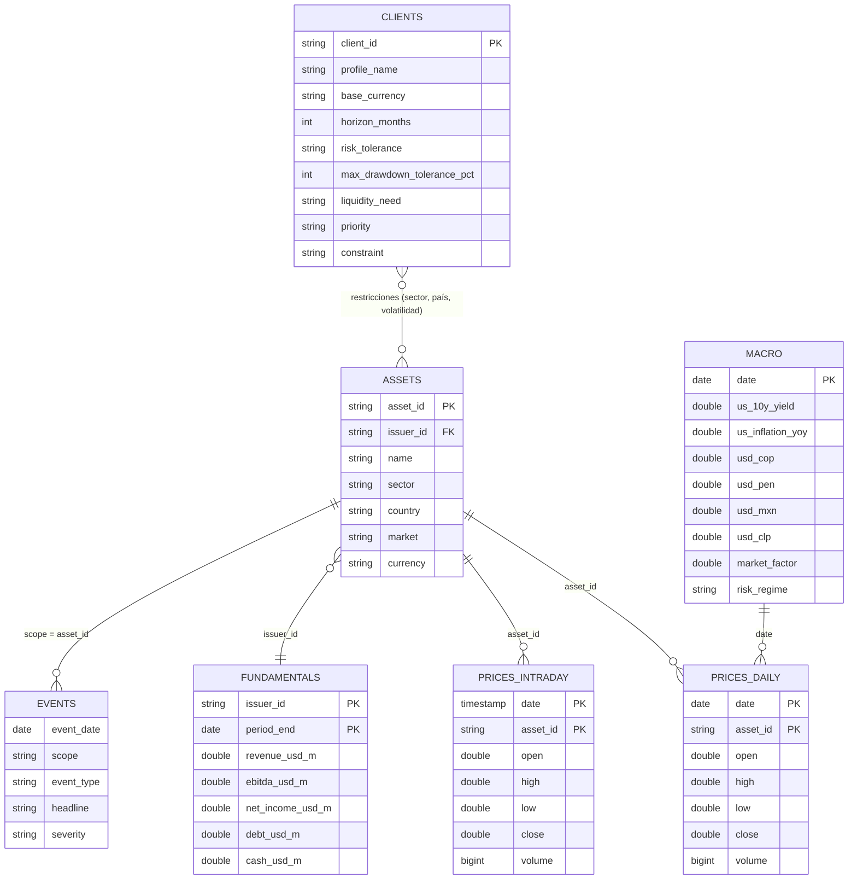

# Modelo de datos

Dataset `dataset_start`: 7 CSV de mercado para 8 activos latinoamericanos y 3 perfiles de cliente.
Los CSV crudos viven en el volumen `workspace.credicorp_hack.raw`; la limpieza (`notebooks/exploracion/explorar_datos.py`)
produce las tablas Delta del schema `workspace.credicorp_hack`. Los CSV no se versionan en este repo.

## Diagrama

## Tablas

| CSV crudo | Tabla limpia | Grano | Clave | Filas (crudo → limpio) | Cobertura |
|---|---|---|---|---|---|
| `01_market_prices_raw.csv` | `silver_prices_daily` | activo × día | `(date, asset_id)` | 2 175 → 2 168 | 2025-08-01 a 2026-08-14 |
| `01_market_prices_raw_expanded.csv` | `silver_prices_intraday` | activo × barra de 10 min | `(date, asset_id)` | 538 836 → 538 800 | 2020-01-02 a 2026-08-14 |
| `02_macro_raw.csv` | `silver_macro` | día | `date` | 271 → 271 | 2025-08-01 a 2026-08-14 |
| `03_fundamentals_raw.csv` | `silver_fundamentals` | emisor × trimestre | `(issuer_id, period_end)` | 65 → 63 | 2024-09-30 a 2026-06-30 |
| `04_asset_reference.csv` | `silver_assets` | activo | `asset_id` | 8 | n/a |
| `05_client_profiles.csv` | `silver_clients` | cliente | `client_id` | 3 | n/a |
| `06_events.csv` | `silver_events` | evento | n/a | 5 | 2026-02-10 a 2026-07-21 |

Tablas derivadas: `dq_log` (correcciones aplicadas), `gold_asset_stats`, `gold_client_summary`, `gold_client_weights`.

## Relaciones

- `prices_daily`, `prices_intraday` → `assets` por `asset_id` (`VF_A01` … `VF_A08`).
- `assets.issuer_id` → `fundamentals.issuer_id` (`ISS_01` … `ISS_08`): un activo por emisor.
- `macro` se une a los precios por `date` (solo días hábiles).
- `events.scope` es un `asset_id` **o** un nombre de sector (p. ej. `Technology`), así que no es una FK estricta.
- `clients` no tiene FK: sus restricciones (`constraint`, `max_drawdown_tolerance_pct`, `risk_tolerance`) se aplican en el análisis.

## Diccionario

### Precios (`prices_daily`, `prices_intraday`)
| Columna | Tipo | Notas |
|---|---|---|
| `date` | date / timestamp | Intradía: barras de 10 min, sesión 09:30–15:50 |
| `asset_id` | string | Normalizado a `VF_Axx` |
| `market`, `currency` | string | Se toman de `assets` (fuente única); todos en USD |
| `open`, `high`, `low`, `close` | double | `high ≥ low` y `close` dentro de `[low, high]` tras la limpieza |
| `volume` | bigint | Puede ser nulo |

### Macro (`macro`)
| Columna | Notas |
|---|---|
| `us_10y_yield` | Rendimiento del bono a 10 años de EE. UU. (%) |
| `us_inflation_yoy` | Inflación anual EE. UU. (%). Se publica mensual; se propagó a los días sin dato (`inflation_is_filled`) |
| `usd_cop`, `usd_pen`, `usd_mxn`, `usd_clp` | Unidades de moneda local por USD |
| `market_factor` | Retorno diario del factor de mercado |
| `risk_regime` | `Normal`, `Stress` o `Recovery` |

### Fundamentales (`fundamentals`)
Cifras trimestrales en millones de USD: `revenue_usd_m`, `ebitda_usd_m`, `net_income_usd_m`, `debt_usd_m`, `cash_usd_m`.
`cash_is_imputed` marca el valor de caja interpolado.

### Referencia de activos (`assets`)
`name`, `sector`, `country` (Colombia, Peru, Mexico, Chile, United States), `market` (`NYSE`, `NYSE ADR`, `NASDAQ`), `currency`.

### Clientes (`clients`)
| Columna | Notas |
|---|---|
| `base_currency` | USD, COP o PEN |
| `horizon_months` | Horizonte de inversión |
| `risk_tolerance` | `Alta`, `Media`, `Media-Baja` |
| `max_drawdown_tolerance_pct` | Caída máxima tolerada (%) |
| `liquidity_need` | `Baja`, `Media` |
| `priority` | Objetivo declarado |
| `constraint` | Restricción en texto libre (p. ej. "Máx. 45% en un solo sector") |

### Eventos (`events`)
`event_date`, `scope` (activo o sector), `event_type` (`Operational`, `Commodity`, `Earnings`, `Demand`, `Sector`), `headline`, `severity` (`High`, `Medium`).

## Problemas de calidad del crudo y su tratamiento

| Problema | Dónde | Tratamiento |
|---|---|---|
| IDs con variantes (`VF-A1`, `VFA03`, `VF_A6`, `ISS04`) | precios, fundamentales | Normalizar a `VF_Axx` / `ISS_xx` |
| Fechas en `MM/DD/YYYY` mezcladas con ISO | precios, intradía | Convertir; se asume mes primero |
| Periodo `Q4-2024` en vez de fecha | fundamentales | Convertir a fin de trimestre |
| Volumen como texto con sufijo `K` | precios, intradía | Multiplicar por 1 000 |
| Ingreso con separador de miles (`1,845.7`) | fundamentales | Quitar la coma |
| Cierre fuera de `[low, high]` (3589 vs ~35.89) | precios | Corregir por factor de escala 10/100/1000 |
| Filas duplicadas | precios, intradía, fundamentales | Conservar la primera por clave |
| `currency` nula | precios, intradía | Completar desde `assets` |
| `volume` nulo | precios, intradía | Se conserva nulo |
| `cash_usd_m` nulo | fundamentales | Interpolar dentro del emisor, con bandera |
| Inflación solo mensual | macro | Propagar al día siguiente, con bandera |
| Filas intradía sin OHLC | intradía | Descartar |

El conteo exacto de cada corrección queda en la tabla `dq_log`.

## Twist (`dataset_twist.csv`)

Archivo adicional con novedades posteriores al corte de los datos (2026-08-14). Vive en el volumen como `dataset_twist.csv`; lo consume `notebooks/analisis/analisis_twist.py`.

| Columna | Notas |
|---|---|
| `release_id` | `TW_01` … `TW_03` |
| `effective_date` | 2026-08-17 |
| `type` | `Macro`, `Client`, `FX` |
| `field` | Variable afectada (`us_10y_yield`, `CL_02_liquidity`, `USD_COP`) |
| `new_information` | La novedad en texto |
| `required_action` | Lo que debe analizarse |

Nota: los cierres de `prices_intraday` difieren de los de `prices_daily` en promedio ~14% (comparando el último cierre de cada día), por lo que no son la misma serie y no se combinan.

## Cómo está guardado en Databricks

Esquema `workspace.credicorp_hack`: 19 tablas Delta *managed*. Se leyó de `information_schema` el 2026-10-31.

- Las claves de las tablas de arriba son **lógicas**: Delta no tiene PK/FK definidas y todas las columnas aceptan nulos. La unicidad la garantiza el notebook de limpieza.
- Las columnas de fecha (`date`, `event_date`, `period_end`) están guardadas como `TIMESTAMP` a las 00:00, no como `DATE`. Usa `CAST(date AS DATE)` al comparar.
- Ninguna tabla ni columna tiene `comment` en Unity Catalog.
- Nombres por capa: `silver_` (datos limpios), `gold_` (resultados que consume el dashboard) y `config_` (parámetros del score). Los CSV crudos del volumen `raw` son la capa bronze.
- Tablas de análisis (escritas por los notebooks de `notebooks/analisis/`):

| Tabla | Filas | Grano | Notebook |
|---|---|---|---|
| `gold_asset_stats` | 8 | activo | `analisis_portafolio` |
| `gold_client_summary` | 3 | cliente | `analisis_portafolio` |
| `gold_client_weights` | 21 | cliente × activo | `analisis_portafolio` |
| `gold_twist_summary` | 3 | novedad del twist | `analisis_twist` |

Versión navegable con buscador de columnas: https://claude.ai/artifact/UWy6UGAk6AvYfH7btANJdo (privada; solo la abre quien tenga acceso).

## Score por cliente

`notebooks/score/00_cargar_config.py` lee `config/*.csv`, valida y escribe `config_limits`, `config_weights` y `config_indicators`.
`notebooks/score/01_calcular_score.py` los usa para evaluar cada cartera candidata de un cliente.

1. **Filtro:** si la cartera incumple un límite duro, queda no apta y no recibe score total.
2. **Score:** cada indicador va de 0 a 100 entre `ancla_0` y `ancla_100`; el grupo es el promedio de sus indicadores y el total pondera los grupos.

| Tabla | Filas | Grano | Para qué |
|---|---|---|---|
| `gold_score_results` | 2 | cliente × cartera | Apta o no, límites incumplidos, score por grupo y total. **La lee el dashboard** |
| `gold_score_detail` | 10 | cliente × cartera × indicador | Valor, anclas y score de cada indicador |
| `gold_limit_checks` | 6 | cliente × cartera × límite | Valor medido frente al límite |
| `gold_portfolio_weights` | 8 | cliente × cartera × activo | Composición de cada cartera |

Un twist nuevo se aplica agregando filas a los CSV de `config/` con otro `twist_id` y `vigente_desde`: por cada clave gana la fila más reciente y las anteriores quedan como historial.
Hoy solo CL_02 tiene configuración.
